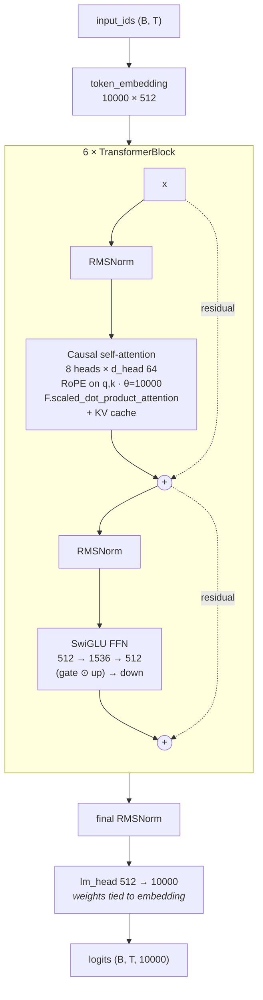
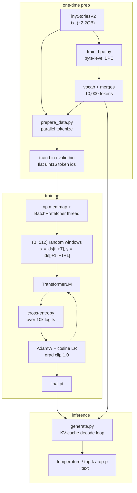

# tlm: a small language model, from scratch

A 25.57M-parameter Llama-style decoder-only transformer and a byte-level BPE tokenizer, both written from scratch (PyTorch and plain Python), trained on TinyStories to generate short children's stories.



*Real output from the trained checkpoint: 153 tokens at 20.9 tok/s on an Apple M4 (MPS, fp32), temperature 0.8, top-k 50, replayed at the speed it was produced.*

**Results:** 25.57M parameters · 655M training tokens (20,000 steps × 32,768 tokens) · validation loss **1.18** nats/token (perplexity 3.25), train loss 1.14.

| | |
| --- | --- |
| **Model** | 6 layers, d_model 512, 8 heads × 64, SwiGLU FFN 512→1536→512, context 512. Pre-norm RMSNorm, RoPE (θ=10,000) on q and k, causal attention via `F.scaled_dot_product_attention`, KV cache for decoding. No biases; `lm_head` tied to the token embedding. |
| **Tokenizer** | Byte-level BPE, 10,000 tokens (256 bytes + `<\|endoftext\|>` + 9,743 merges), GPT-2 pre-tokenization regex, trained on TinyStoriesV2 itself. Trainer counts pre-tokens in parallel and updates pair counts incrementally (inverted index + lazy max-heap) instead of recounting each merge. |
| **Training** | Next-token cross-entropy, AdamW (β 0.9/0.95, wd 0.1 on matrices only), 500-step linear warmup to 3e-4, cosine decay to 3e-5, grad clip 1.0, batch 64 × 512, bf16 autocast + `torch.compile` on CUDA. Trained on AWS EC2. |
| **Inference** | Prompt prefill in one forward pass, then one token per step against the KV cache; temperature, top-k, top-p sampling. |

## Quickstart

Requires [uv](https://docs.astral.sh/uv/) and Python 3.12–3.13.

```bash
uv sync

# 1. Data: TinyStoriesV2 (GPT-4 split) into data/
mkdir -p data
curl -L -o data/TinyStoriesV2-GPT4-train.txt https://huggingface.co/datasets/roneneldan/TinyStories/resolve/main/TinyStoriesV2-GPT4-train.txt
curl -L -o data/TinyStoriesV2-GPT4-valid.txt https://huggingface.co/datasets/roneneldan/TinyStories/resolve/main/TinyStoriesV2-GPT4-valid.txt

# 2. Tokenize with the committed vocab -> data/train.bin, data/valid.bin (uint16)
uv run python scripts/prepare_data.py

# 3. Train (defaults reproduce the reported run; add --wandb to log)
uv run python -m tlm.train.train
#    -> workspace/checkpoints/final.pt

# 4. Sample
uv run python scripts/generate.py --checkpoint workspace/checkpoints/final.pt --prompt "Once upon a time"

# Streamlit UI (expects the checkpoint at tlm-model/final.pt)
cp workspace/checkpoints/final.pt tlm-model/final.pt
uv run streamlit run app.py
```

The trained checkpoint (307MB, weights plus AdamW state) is not committed; it exceeds GitHub's file size limit. The tokenizer is committed (`workspace/` and an identical copy in `tlm-model/`), so retraining it is optional: `uv run python scripts/train_bpe_tinystories.py`.

## Model

Pre-norm, decoder-only, architecturally closer to Llama than to GPT-2:



| Choice | Instead of | Why |
| --- | --- | --- |
| RMSNorm | LayerNorm | No mean subtraction, no bias; cheaper and as stable in practice |
| RoPE | learned / sinusoidal position embeddings | Relative position enters attention directly; no position parameters |
| SwiGLU | ReLU/GELU MLP | Better loss per parameter at the same FLOPs |
| Pre-norm | post-norm | Clean residual path, stable training |
| Tied embeddings | separate `lm_head` | Saves 5.12M params (20% of the model) |
| No biases | biases on linears | Fewer parameters, no measurable quality cost |
| SDPA | hand-written attention matmul | Dispatches to fused flash attention on CUDA |

Implementation notes: RoPE rotates interleaved (even, odd) pairs with cos/sin tables precomputed up to the context length, and both RoPE and RMSNorm compute in fp32 before casting back. Weights are initialized N(0, 0.02), with the attention output and FFN down projections scaled by 1/√(2·n_layers).

**Parameter count** (`d_model=512, n_layers=6, n_heads=8, d_ff=1536, context_length=512, vocab_size=10000`):

| | |
| --- | --- |
| Total | **25.57M** |
| Non-embedding | 20.45M |
| Token embedding (tied with `lm_head`) | 5.12M |
| Attention, 6 blocks | 6.29M |
| SwiGLU FFNs, 6 blocks | 14.16M |
| RMSNorm scales (13) | 0.007M |

## Training

The loss is mean next-token cross-entropy over every position in a `(B, 512)` batch of random windows, with targets shifted by one ([transformer.py](tlm/model/transformer.py)). Validation uses the same loss on `valid.bin`, averaged over 50 random batches every 500 steps ([train.py](tlm/train/train.py)).

| | loss (nats/token) | perplexity | bits/token |
| --- | --- | --- | --- |
| Train | **1.14** | 3.13 | 1.64 |
| Validation | **1.18** | 3.25 | 1.70 |

The 0.04-nat train/val gap after roughly one pass over the data, with dropout 0, indicates essentially no overfitting. The model is fluent and grammatical within TinyStories' simple register, which is what a 25M-parameter model on this corpus should achieve.

Recipe (the defaults in `train.py`, used for the reported run):

| | |
| --- | --- |
| Steps | 20,000 |
| Batch | 64 sequences × 512 tokens = 32,768 tokens/step |
| Tokens seen | ≈ 655M (about one pass over TinyStoriesV2) |
| Optimizer | AdamW, β=(0.9, 0.95), ε=1e-8, fused on CUDA |
| Weight decay | 0.1 on the 31 matrix/embedding tensors, none on the 13 RMSNorm scales |
| LR schedule | linear warmup 500 steps to 3e-4, cosine decay to 3e-5 |
| Grad clipping | max norm 1.0 |
| Precision | bf16 autocast on CUDA (fp16 + GradScaler fallback), fp32 on MPS/CPU |
| Compile | `torch.compile` when CUDA is present |
| Data loading | `np.memmap` over uint16 token files, batches prefetched on a background thread |

## Tokenizer

Byte-level BPE in the GPT-2 style: text is split on `<|endoftext|>`, pre-tokenized with the GPT-2 regex, and merges are learned over UTF-8 bytes until the vocabulary reaches 10,000. Training on TinyStories itself keeps common story words ("Once upon a time", names, "The end") to one or two tokens, and keeps the tied embedding table at a fifth of the model. `<|endoftext|>` separates documents during data prep and is the stop token during generation. Encoding applies merges in learned rank order per pre-token ([tokenizer.py](tlm/tokenizer.py)); training is in [train_bpe.py](tlm/train_bpe.py).

## Pipeline



## Repo layout

```
├── app.py                         # Streamlit UI, streams tokens from tlm-model/final.pt
├── demo.svg                       # the recording above
├── tlm-model/                     # tokenizer for the Streamlit app (place final.pt here)
├── workspace/                     # trained tokenizer: vocab + merges (10,000 tokens)
├── tlm/
│   ├── tokenizer.py               # BPE encode/decode
│   ├── train_bpe.py               # BPE training
│   ├── pretokenization_example.py # find_chunk_boundaries, splits files for parallel work
│   ├── generate.py                # KV-cache decode loop, temperature / top-k / top-p
│   ├── model/                     # config, rmsnorm, rope, attention, feedforward (SwiGLU), block, transformer
│   └── train/                     # data (memmap + prefetch), optim (AdamW groups, cosine LR), checkpoint, train loop
└── scripts/
    ├── prepare_data.py            # TinyStories .txt -> train.bin / valid.bin (multiprocess)
    ├── train_bpe_tinystories.py   # retrain the BPE vocab
    └── generate.py                # CLI sampling from a checkpoint
```
